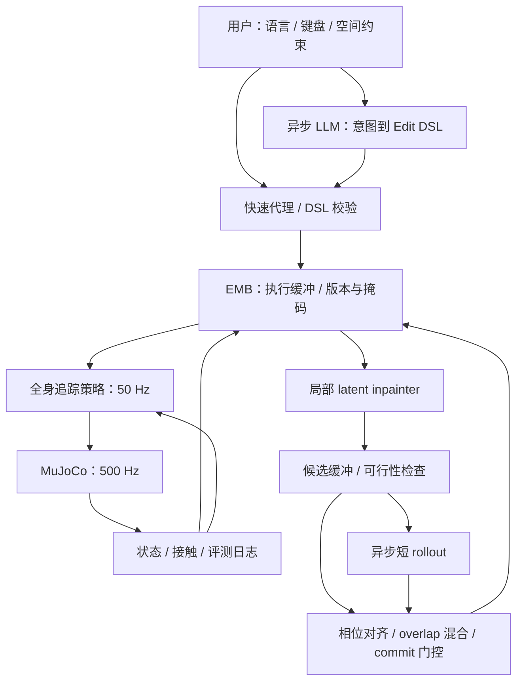

# PhaseMend

**Phase-Aligned Online Motion Editing for Humanoid Tracking**  
**支持实时介入编辑的人形机器人全身动作追踪**

在机器人持续追踪动作的过程中，让人通过语言、键盘或空间约束修改未来动作，并通过相位对齐与受控接管保持动作连续。

> **当前状态：研究规划阶段。** 下列数值是设计目标和验收门槛，尚非实验结果。项目基于原始课程研究方案 v1.0，周期为 12 周、6 次双周汇报；使用单卡 RTX 4070（12 GB），仅做仿真。

[每周详细任务与检验清单](docs/weekly-plan.md)

## 研究目标

核心问题是：**如何维护一条可被在线修改、同时对下游追踪控制器友好的运动参考流？**

项目同时研究连续追踪（continuity）、在线编辑（editability）和实时响应（latency）。主要假设是：显式建模接触与相位的运动中间表示，结合相位对齐接管和针对参考扰动的策略训练，可以降低在线编辑造成的追踪失稳。

拟验证的贡献包括：

- **Editable Motion Buffer（EMB）**：支持局部编辑、历史保留、候选提交与版本回滚的运动中间表示。
- **相位对齐的在线接管**：双缓冲、重叠混合和 commit 门控，缓解支撑脚错配及参考突变。
- **Edit-robust tracking**：通过时间扭曲、片段拼接、future dropout 和参考冻结增强，提高追踪器对参考变动的鲁棒性。
- **异步语义编译**：LLM 将意图编译为受限 Edit DSL，快速代理负责可识别指令的初步响应。

创新性、相关工作的能力边界和方法收益均需通过文献核查及实验确认；“首个”“空白”“优于现有方法”等表述不作为当前结论。

## 范围与工程约束

| 项目 | 计划 |
|---|---|
| 机器人 | Unitree G1，目标配置为 29 DoF；实际资产、关节顺序和 checkpoint 必须核对一致 |
| 硬件 | 单卡 RTX 4070，12 GB 显存；训练与演示分时运行 |
| 训练 / 部署 | 优先 Isaac Lab 训练或微调，MuJoCo 部署、评测与演示 |
| 追踪器 | 优先复用可用且兼容的开源 checkpoint；从零训练作为最后退路 |
| 数据 | 优先 AMASS 子集；访问、格式及许可不满足时评估其他合法可用数据 |
| 周期 | W1–W12；未指定日历开工日，周次从实际开工起算 |
| MVS | W8 跑通键盘 / DSL 在线闭环编辑；W10 接入完整自然语言编译与交互评估 |
| 最终交付 | 可交互 demo、4 组 baseline、消融与指标表、延迟报告、PDF 报告、视频、代码 zip |

PHC、OmniH2O 等作为追踪方法与工程参考，不预设它们的权重可直接控制本项目的 G1。W1 必须核查机器人、观测、动作、PD 参数、仿真后端和权重接口。数据集及外部模型分别遵循其自身许可。

## 系统设计



| 模块 | 职责 | 初始技术路线 | 验证重点 |
|---|---|---|---|
| L1 语义编译 | 自然语言与状态摘要 → Edit DSL | Qwen2.5-7B-Instruct 4bit 为初始候选；可降至小模型 / 模板 | 合法性、语义正确率、显存、降级行为 |
| L2 EMB | 环形缓冲、编辑掩码、版本、撤销、提交 | 历史 0.5 s + 执行上下文 1.0 s + 未来 2.0 s 为初始配置 | 时间语义、前缀保护、候选过期、回滚一致性 |
| L3 修复器 | 在局部窗口内满足编辑条件 | MDM 风格 latent inpainter，借鉴 MotionLCM 少步采样；MoMask 为候选 | 检查点及特征兼容性、约束满足率、推理耗时 |
| L4 追踪器 | 参考与本体状态 → PD 目标 | 兼容 G1 的开源策略 + 必要微调 + edit-robust 增强 | 无编辑基线、sim-to-sim 迁移、切换稳定性 |
| L5 仿真 | 动力学、接触与状态反馈 | MuJoCo 部署；训练后端优先 Isaac Lab | 单位、关节映射、惯量、PD、接触与步长 |

训练后端和 MuJoCo 对齐资产、观测、归一化及 PD 语义，并单独验证迁移误差。生成器拟控制在 30 M 参数以内，尝试 fp16、缓存与 ONNX / TensorRT；是否采用加速后端由实测收益决定。

### 运动表征与 Edit DSL

采用三层表征：生成 / 编辑层以 22 关节 6D 旋转、根位姿与速度、4 维足接触和显式相位为设计起点；桥接层使用 FK 关键点、相位与 IK；执行层使用 G1 关节目标。坐标系、单位、旋转约定和准确维数在 W1 定义草案，W5 冻结 EMB v1。

接触与相位是编辑层和执行层的接口约束。时间伸缩时应同步重采样接触与相位；局部上半身编辑则尽量保持下肢参考。外部生成模型需要专门的特征适配，不预设现有权重能直接处理 EMB。

| 算子 | 语义 | 例子 |
|---|---|---|
| `replace` | 用新片段替换窗口 | “改成挥手” |
| `warp` | 伸缩时间、调整速度 | “慢一点” |
| `spatial_key` | 指定时刻 / 短窗的空间约束 | “左手抬高 20 cm” |
| `part` | 仅编辑指定身体部位 | “只改上半身” |
| `style` | 调整幅度或风格 | “别这么夸张” |
| `inpaint` | 固定上下文，补全中间片段 | “在这里插一个转身” |

以下为待实现的 DSL 示例；W1 先约定最小字段，W5 固化基础接口，W9 补全语义编译约束：

```json
{
  "utterance": "两秒后慢一点",
  "ops": [
    {
      "op": "warp",
      "window": {"mode": "relative", "start": 2.0, "end": 4.0},
      "speed": 0.7,
      "preserve_phase": true,
      "strength": 0.9
    }
  ],
  "hard_constraints": ["foot_contact_consistency", "no_self_collision"],
  "fallback": "degrade_to_lod_1"
}
```

相对时间以请求接收时刻为锚点，内部转换为统一仿真时间。原方案中的 `spatial-key` / `spatial_key` 统一为 `spatial_key`；`root_key` 的语义归入根节点的空间约束，具体 schema 在接口冻结时确定。撤销属于版本事务，不另列为第七个生成算子。

### 在线接管与鲁棒性

1. 快速代理或 LLM 提交经 schema 校验的请求，EMB 确定固定帧、自由帧和约束帧。
2. 修复器生成候选；执行缓冲持续供给旧参考。
3. 在接触相位兼容的候选中搜索对齐偏移，初始范围为 ±3 帧，共 7 个离散偏移；结合姿态、足位置和根速度差评分。
4. overlap 内采用平滑权重混合；旋转必须采用有效的旋转插值 / 重正交化方法。
5. commit 检查接触相位、关节速度差、自碰撞及所选平衡筛查指标；不满足则延迟，最多重试 3 个控制周期，再拒绝或降级。
6. 异步短 rollout 用于进一步筛查；候选须带版本号，防止迟到结果覆盖新编辑。失败时受控回滚未来参考，已执行的物理轨迹不可撤销。

几何、运动学与短 rollout 都是筛查手段。质心投影、ZMP 余量等指标需要说明适用动作范围，不能单独作为动态平衡保证。最终可执行性以闭环 rollout 为准。

edit-robust 训练使用四类参考增强：随机时间扭曲 ±20%、随机片段拼接、future dropout、随机 0.2 s 参考冻结。与普通训练对照时统一初始权重、训练预算、数据划分和评测场景。

## 实时性与验收指标

计划采用物理仿真 500 Hz、追踪控制 50 Hz、融合层 50 Hz，修复器与 LLM 事件驱动。参考采样率、预览帧数、修复窗口和提交保护前瞻分别配置。

| 环节 | P50 预算 | P95 预算 |
|---|---:|---:|
| 快速代理 | 8 ms | 20 ms |
| DSL 校验与掩码 | 3 ms | 8 ms |
| 局部修复 | 35 ms | 70 ms |
| 相位对齐与混合 | 4 ms | 10 ms |
| 下一控制 / 展示帧 | 20 ms | 40 ms |
| LLM 精确解析，异步 | 600 ms | 1200 ms |

上表是原方案的模块预算，不是实测结果；各模块分位数不能直接相加得到端到端分位数。实际端到端延迟必须独立测量，包含排队、保护前瞻、门控等待、下一控制帧及展示等待。

**首周必须解决的时间口径问题：**原方案同时提出“仅修改未来 0.2 s 之后的参考”和“输入到画面可见响应 P50 < 150 ms”。若保持严格 200 ms 保护前瞻，两者不能同时满足。W1 需记录选择：调整可配置保护前瞻，或经项目负责人确认修订目标；在确认前保留原目标并标记该冲突，不能用候选生成延迟替代可见响应延迟。另需区分 200 ms 保护前瞻、修复窗口和 20–40 帧上下文，禁止混用。

| 维度 | 原方案目标 | 检验口径 |
|---|---|---|
| 响应 | P50 < 150 ms；P95 < 350 ms | 请求到首次满足该请求的机器人可见动作；另报首次粗响应、完整约束生效与各模块耗时 |
| 追踪 | 根位置误差 < 8 cm | 根位置误差与全身 / 根对齐 MPJPE 分开报告；W4 阶段门槛为根误差 < 15 cm |
| 接触 | 支撑足滑速度 < 5 cm/s；0 穿地 | 明确接触判据、地面高度与数值容差；报告超容差穿地帧比例 |
| 编辑保真 | 硬约束满足率 > 85% | 在请求规定的时间窗和容差内统计；拒绝 / 超时不能从分母剔除 |
| 平滑性 | 交接窗 jerk 峰值 < 线性 crossfade 的 50% | 相同采样率、滤波和交接窗；同时报告实际数值 |
| 稳定性 | 摔倒率 < 10% | 预先冻结 episode 时长、摔倒判据、重复次数和随机种子 |
| 可用性 | n=10；完成率 > 80%；SUS > 70 | 使用固定任务与问卷；缩小样本时报告实际人数 |

快速代理仅对已覆盖的意图生效。开放词汇请求如必须等待 LLM，需将等待计入该类请求的端到端延迟，并单独报告缓存命中率与降级率。

## 实验设计

| 场景 | 请求 | 主要检验点 |
|---|---|---|
| E1 | “慢一点 / 快一点” | 时间伸缩与相位一致性 |
| E2 | “往左走两步” | 根轨迹编辑、接触与稳定性 |
| E3 | “左手举高” | 局部编辑保真与下肢保持 |
| E4 | “别这么夸张” | 风格 / 幅度语义 |
| E5 | “做一个挥手” | 插入片段与前后衔接 |
| E6 | “撤销刚才” | 未来参考回滚、版本与并发一致性 |

四组 baseline 为：**Baseline-1** 整段重生成 + 硬切换；**Baseline-2** 线性 crossfade；**Baseline-3** MotionLCM 式流式重生成；**Baseline-4** 无编辑参考。无编辑参考用于估计追踪代价，编辑保真和语言指标标为不适用。Baseline-3 必须明确复现范围、适配方式和 checkpoint，不能仅凭名称视为完整复现或 SOTA 上界。

五组消融：LLM vs 模板 DSL；inpainting vs 纯 blending；相位对齐 vs 时间对齐；edit-robust vs 普通追踪器；乐观异步 vs 同步等待。优先检验 edit-robust 和相位对齐对摔倒率、足滑与 jerk 的影响。

评测统一场景、请求时刻、动作集与随机种子；训练动作与测试动作分离。正式评测计划每个适用的“场景 × 方法”至少 20 次独立 episode，公开计数、失败案例、配置及原始日志；W8 前先用较小固定集合做工程验收。

## 12 周计划与检验点

每周产出可运行 demo、配置、原始日志、指标摘要和未通过项；偶数周做一次正式汇报。全部检验清单见 [weekly-plan.md](docs/weekly-plan.md)。以下均为待完成计划。

| 周次 | 核心任务 | 周末交付 | 必须通过的检验点 |
|---|---|---|---|
| W1 | 环境、资产 / checkpoint 核查、数据访问、接口与计时口径草案 | 环境锁定记录、资源矩阵、最小 schema、MuJoCo 静态 demo | G1 可加载；依赖 / 权重匹配或替代路径明确；登记 200 ms 与 150 ms 冲突的决策状态 |
| W2 · R1 | 重定向与开环播放；完成文献矩阵 | ≥1 段 ≥10 s 开环视频、转换配置、20 项文献核查表 | 输入到 G1 播放可复现；无 NaN / 越限；区分开环与闭环 |
| W3 | 接入兼容追踪策略，建立无编辑评测 | 单段闭环 demo、观测 / 动作适配记录、误差与摔倒日志 | ≥1 段连续追踪 ≥10 s 不摔；普通追踪基线可复跑 |
| W4 · R2 | 微调与 sim-to-sim 对齐，建立追踪基线 | 3–5 段动作、checkpoint、根误差 / 摔倒率曲线 | 固定验收动作均能连续追踪 ≥10 s；根误差 <15 cm；不通过即启动缩范围路线 |
| W5 | EMB v1、版本事务、六类算子接口、基础确定性编辑 | schema、离线编辑工具、撤销 / 超时 demo | 已执行前缀不变；候选隔离；版本、相对时间及非法请求校验通过 |
| W6 · R3 | 局部条件修复，补齐六算子演示与可行性筛查 | 固定前缀 + 硬约束 demo、离线指标、闭环回放 | 冻结样例集约束满足率 >70%；能闭环执行；<60% 切换修复方法 |
| W7 | 双缓冲、相位对齐、commit 门控；edit-robust 微调 | 连续在线编辑 demo、拒绝 / 降级日志、普通与增强策略对比初版 | 注入延迟时控制不中断；E1–E3 可提交；迟到候选不能覆盖新版本 |
| W8 · R4 | 在线 MVS 与真实延迟评测 | 不剪辑键盘编辑视频、延迟分解、E1–E3 指标表 | P95 <350 ms；E1–E3 验收录屏不摔；按预先冻结口径检查其余 MVS 指标及 P50 冲突决策 |
| W9 | LLM→DSL、状态上下文、快速代理与降级 | 自然语言 demo、独立指令测试集、编译 / 并发日志 | 非法 DSL 不执行；解析最多重试 2 次；断开 LLM 后模板 / 键盘仍可用 |
| W10 · R5 | 语义正确率与异步消融；用户研究 | LLM vs 模板结果、n=10 用户研究初版、完整交互 demo | NL→DSL 语义成功率 >85%；“响应及时”均分 >4/5；记录完成率和 SUS |
| W11 | 四组 baseline + 五组消融正式评测 | 全量日志、汇总表、图、失败案例 | 所有适用组合有结果；公平预算和独立测试集核查通过；失败不漏报 |
| W12 · R6 | 复现、报告、演示与发布材料 | PDF、连续演示视频、代码 zip、环境与权重说明 | 干净环境可复现 demo；一条命令从冻结结果生成全部图表；完整实验入口已核验；至少 3 个指标支撑报告结论 |

### 红线与替代路线

下表将原方案中分散的红线合并执行；替代路线编号与实验 baseline 编号无关。

| 检查时点 / 触发条件 | 动作 | 需保留的证据 |
|---|---|---|
| W1 末关键权重、数据或训练后端不可用 | 固定可用的兼容资产与最小动作集；尽早验证上半身 / 站立路径 | 兼容性与访问记录、替代成本 |
| W4 无法连续追踪 10 s | Plan B1：站立 / 慢走 + 上半身编辑；若追踪器仍不可用，再评估 Plan B2：IK + 平衡补偿 | 同场景失败视频与误差；不宣称 IK 自动保证稳定 |
| W6 约束满足率 <60% | 修复器改走测试时优化路线；60%–70% 记为未达标并限时修复 | 固定样例上的生成与优化对照 |
| W8 P95 在 350–500 ms | 未通过 R4；冻结功能扩展，按分段计时定位瓶颈 | 快速代理、修复、等待和展示的独立耗时 |
| W8 P95 >500 ms 或在线稳定性仍失败 | 缩至 DSL / 键盘及 Plan B1；仍不能满足在线目标时启用 Plan B3：编辑—预演—播放 | 如实标注离线 / 在线范围；异步 LLM 移除后也须重测 |
| LLM 不可靠或显存超限 | Plan C：小模型 → 模板 / 槽位 → 快捷键 | 解析失败、显存峰值、降级率 |
| W10 无法组织 n=10 | 作者评估 + 3 人小样本，标注实际样本；不足 3 人则报告实际情况 | 实际人数、任务、问卷与限制 |

## 资源预算与工程纪律

GPU 总预算暂按原方案 **100–150 h** 管理，W1 基准实测后更新。原文“两轮各 2–3 天追踪微调”与“总计 100–150 h”存在上界不一致，不能同时按满额安排；先做短程试跑，采用累计 GPU 小时硬记录，必要时缩减动作集、训练轮数或模型规模并登记原因。

- 优先兼容 checkpoint；训练并行环境从小规模试跑，再按显存实测扩到 1024–2048。
- EMB / DSL 接口先约定，版本化修改；各模块支持独立运行及替身输入。
- 所有实验配置化，记录代码版本、数据版本、权重来源、随机种子、训练时长与显存峰值。
- 每周 demo review 决定是否缩范围；未通过的验收项保持可见。
- 计划中的命令入口在实现后再给出真实用法；当前仓库不宣称已有可运行系统。

## 文献与方案依据

本项目以项目负责人提供的《支持实时介入编辑的人形机器人全身动作追踪——课程研究方案》v1.0 为规划依据。原始方案汇总了 20 项文献 / 工作，涉及 MDM、T2M-GPT、MoMask、MotionGPT、PriorMDM、OmniControl、ACMDM、MotionLCM、AMASS、PHC、OmniH2O、ExBody 系列、SayCan、VoxPoser、Code as Policies、Language to Rewards、VLA、MotionStreamer、TLControl 和交互式运动编辑。

W1–W2 核对原论文、官方代码、checkpoint、许可与适用条件；可疑名称或元信息保留待核对标记。方向 A 为当前主线；Reward-as-Edit（方向 B）和运动 token 编辑（方向 C）保留为候选子模块或替代研究路线，优先保证 W8 的在线闭环。

## 计划维护

README 是当前执行摘要，详细周计划记录任务和检验方法。后续需求、实验发现和范围调整需同步更新执行文档、保留变更原因；项目负责人的最新说明优先。
